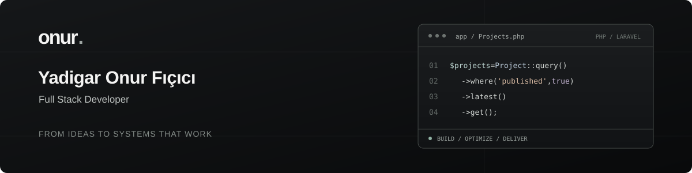

  

I build web applications that bring together the interface, application logic, data and infrastructure. My work spans CRM systems, learning platforms, e-commerce and operational tools — with a focus on practical solutions, performance and automation.

### What I build

- **Custom web applications:** Full stack systems, administration panels and API integrations.
- **CRM & automation:** Order workflows, customer operations, reporting and tools that reduce repetitive work.
- **Learning platforms:** Course delivery, exams, progress tracking and management systems.
- **E-commerce & marketplaces:** Custom storefront infrastructure, order management and platform integrations.
- **Technical SEO & performance:** Search-friendly architecture, structured data and a faster user experience.

### Selected work

- [**Free Laser Cut Files**](https://freelasercutfiles.com/) — A Laravel-based digital design platform with a searchable content catalog, downloads and management workflows.
- **E-commerce & CRM infrastructure — Yıldem** — A PhalconPHP system connecting sales pages, a central order pool, automated agent assignment and operational reporting.
- **Learning management systems — Dahiders & Hocalara Geldik** — PhalconPHP platforms combining course content, assessments, progress analysis and management tools.
- **Biletalsat — Ticket Marketplace** — A PhalconPHP platform bringing event listings, ticket sales and order management together.
- **Compressor service tracking** — A custom PHP application for equipment records, maintenance plans and service history.

### Technologies

- **Backend:** PHP, Laravel, PhalconPHP, REST APIs, queues and background jobs
- **Frontend:** JavaScript, TypeScript, Blade, Livewire, jQuery and Tailwind CSS
- **Data:** MySQL, MariaDB, MongoDB, Redis and Memcached
- **Infrastructure:** Linux, Nginx, Apache, Cloudflare and server management
- **Commerce & search:** Custom e-commerce, OpenCart module development, Shopify integrations and technical SEO

---

[Personal website](https://onurficici.com.tr/) · [LinkedIn](https://www.linkedin.com/in/onurficici/)
